# ReservaUNAB móvil (Hito 4)

Aplicación móvil en **React Native con Expo** para el caso **3.1 Gestión de espacios universitarios**. Es un segundo
cliente de la misma API REST del [Hito 3](https://github.com/Camilo-Quintana/Hito3-agenda-salas-universitario-FullStack): no tiene backend ni base de datos propios. Todo lo que se reserva o cancela
desde el teléfono se guarda en PostgreSQL (y su historial en MongoDB) a través de la API, y aparece también en la
aplicación web.

```
 Aplicación web (React)     Aplicación móvil (React Native)
              \                 /
               API REST NestJS  (backend/ del Hito 3)
                /           \
          PostgreSQL       MongoDB
```

## Funcionalidades (sección 3.1 del enunciado)

| Requisito | Dónde está en la app |
|---|---|
| Consultar edificios, salas y laboratorios, con capacidad, equipamiento y disponibilidad | Pestaña **Espacios** (búsqueda, filtros por edificio y tipo, horarios libres del día) y pantalla **Espacio** (datos, equipamiento y estado de cada bloque horario) |
| Consultar las reservas propias y sus estados | Pestaña **Mis reservas** (activas e historial) y pantalla **Mi reserva** (detalle y línea de tiempo guardada en MongoDB) |
| Solicitar una reserva | Tocar un bloque **Libre** en la pantalla Espacio → formulario **Nueva reserva** |
| Cancelar una reserva propia cuando corresponda | Botón **Cancelar esta reserva** en **Mi reserva**. Solo aparece si la reserva está pendiente o aprobada y aún no empieza (la API vuelve a validar esa regla) |

Además: inicio de sesión con la cuenta de la API (token JWT guardado en el almacenamiento seguro del teléfono, así
la sesión se mantiene al cerrar la app) y pestaña **Perfil** con los datos del usuario, la dirección de la API en uso
y el cierre de sesión.

## Requisitos

- Node.js 20 o superior.
- La API del Hito 3 encendida: está en el [repositorio del Hito 3](https://github.com/Camilo-Quintana/Hito3-agenda-salas-universitario-FullStack) y se levanta con Docker.
- Docker Desktop, para correr la API.
- Para ver la app, una de estas opciones:
  - **Emulador de Android** (Android Studio → Device Manager → un Pixel con imagen de Google Play). Recomendado para la demostración.
  - **Celular con Expo Go** (Play Store o App Store) conectado a la misma red Wi-Fi que el computador.

La app usa el **SDK 58 de Expo**. Expo Go debe estar actualizado en el teléfono.

## Instalación y ejecución

```bash
# 1. Levantar la API del Hito 3 (con PostgreSQL, MongoDB y la web)
git clone https://github.com/Camilo-Quintana/Hito3-agenda-salas-universitario-FullStack.git hito3
cd hito3
cp .env.example .env        # en PowerShell: Copy-Item .env.example .env
docker compose up -d --build
cd ..

# 2. Instalar y abrir la app móvil (este repositorio)
git clone https://github.com/Camilo-Quintana/Hito4-agenda-salas-universitario-ReactNative.git hito4
cd hito4
npm install
npx expo start
```

Para confirmar que la API está encendida, abre http://localhost:3000/api/salud. La web queda en http://localhost:8080.

> En Windows, si PowerShell dice que *la ejecución de scripts está deshabilitada*, usa `npm.cmd` y `npx.cmd`, o
> corre una vez `Set-ExecutionPolicy -Scope CurrentUser RemoteSigned`.

En la terminal de Expo:
- presiona **`a`** para abrirla en el emulador de Android, o
- escanea el código QR con Expo Go (Android) o con la cámara (iPhone).

Cuenta de prueba: `demo@uandresbello.edu` / `Demo1234` (en la pantalla de ingreso está el enlace
"Usar la cuenta de prueba", que la completa).

## Configuración de la dirección de la API

La dirección se define en `src/config.js` y se elige en este orden:

1. **`EXPO_PUBLIC_API_URL`** en el archivo `.env` de este repositorio, si existe (hay un ejemplo en `.env.example`).
2. Si no, la **IP del computador que corre `npx expo start`**, con el puerto `3000` (o `EXPO_PUBLIC_API_PORT`).
   Así funciona sin configurar nada en Expo Go y en el emulador, siempre que la API esté en el mismo computador.
3. Si no se puede saber, `http://10.0.2.2:3000/api` en el emulador de Android (esa IP apunta al computador) o
   `http://localhost:3000/api` en el simulador de iOS.

La dirección en uso aparece abajo en la pantalla de ingreso y en la pestaña **Perfil**.

| Dónde corre la app | Valor de `EXPO_PUBLIC_API_URL` |
|---|---|
| Emulador de Android | `http://10.0.2.2:3000/api` |
| Celular con Expo Go en la misma red | `http://IP-DEL-COMPUTADOR:3000/api` (Windows: `ipconfig`, Linux/Mac: `ip addr` o `ifconfig`) |
| API desplegada | `https://tu-servidor/api` |

Después de cambiar `.env`, reinicia Expo con `npx expo start -c`.

**Si la app dice "Sin conexión con la API":** revisa que `http://localhost:3000/api/salud` responda en el
computador, que el celular esté en la misma red Wi-Fi y que el firewall de Windows permita el puerto 3000. En redes
universitarias que bloquean la conexión entre equipos, usa el emulador o comparte internet desde el celular.

> El navegador exige CORS, pero las apps nativas no: no hay que cambiar `CORS_ORIGIN` de la API para el móvil.

## Endpoints de la API que usa la app

| Método | Endpoint | Pantalla | Para qué |
|---|---|---|---|
| POST | `/api/auth/login` | Ingresar | Iniciar sesión y obtener el token JWT |
| GET | `/api/auth/yo` | (al abrir la app) | Confirmar que la sesión guardada sigue vigente |
| GET | `/api/edificios` | Espacios | Filtro por edificio, con pisos y cantidad de espacios |
| GET | `/api/espacios?q&tipo&edificioId&fecha` | Espacios | Catálogo con filtros y horarios libres del día (`bloquesLibres`) |
| GET | `/api/espacios/:id` | Espacio | Detalle con edificio, capacidad y equipamiento |
| GET | `/api/espacios/:id/disponibilidad?fecha` | Espacio | Estado de cada bloque: libre, ocupado o pasado |
| POST | `/api/reservas` | Nueva reserva | Crear la reserva (aprobada, o pendiente si el espacio requiere aprobación) |
| GET | `/api/reservas/mias?vista=activas\|historial` | Mis reservas | Reservas propias y sus estados |
| GET | `/api/reservas/:id` | Mi reserva | Detalle de una reserva propia |
| GET | `/api/reservas/:id/historial` | Mi reserva | Línea de tiempo (eventos guardados en MongoDB) |
| PATCH | `/api/reservas/:id/cancelar` | Mi reserva | Cancelar una reserva propia, con motivo opcional |

No se agregaron ni modificaron endpoints: la app usa la API del Hito 3 tal como está. Las reglas de negocio
(bloque ocupado, una reserva por día, capacidad, anticipación de 7 días, qué se puede cancelar) siguen en el backend.

## Flujos implementados

1. **Ingresar.** Valida correo y contraseña en el teléfono y muestra el error de la API si no coinciden.
2. **Buscar un espacio.** Búsqueda por nombre o equipamiento (espera a que dejes de escribir), filtros por edificio
   y tipo, y selector de día. Cada tarjeta muestra capacidad, equipamiento, horarios libres y si requiere aprobación.
3. **Ver disponibilidad.** En el detalle del espacio se elige el día y se ven los 13 bloques de 08:00 a 21:00:
   libres (verde, se pueden tocar), ocupados y ya pasados.
4. **Reservar.** Se toca un bloque libre, se escribe el motivo y se eligen los asistentes con los botones − y +
   (no se puede pasar de la capacidad). Al confirmar aparece la confirmación o, si el espacio requiere aprobación,
   "Solicitud enviada". Si la API rechaza (por ejemplo, "Ya tienes una reserva ese día" o el bloque se ocupó
   mientras tanto), se muestra el mensaje y la opción de elegir otro horario.
5. **Mis reservas.** Activas e historial, con el estado de cada una. Se actualiza al volver a la pestaña y al
   deslizar hacia abajo.
6. **Cancelar.** En el detalle de la reserva, con motivo opcional y una confirmación antes de enviarla. El bloque
   queda libre y la reserva aparece cancelada también en la web.

**Estados de interfaz:** cada consulta muestra un indicador de carga, un mensaje de error con botón "Reintentar"
(distingue la falta de conexión de otros errores), un mensaje cuando no hay resultados y avisos de confirmación.
Si el token vence (8 horas), la app vuelve a la pantalla de ingreso y lo avisa.

## Capturas

Tomadas en el emulador de Android (Medium Phone, API 37) con la API del Hito 3 corriendo en Docker y la cuenta de prueba.

| Ingresar | Validación | Espacios | Filtros |
|---|---|---|---|
| 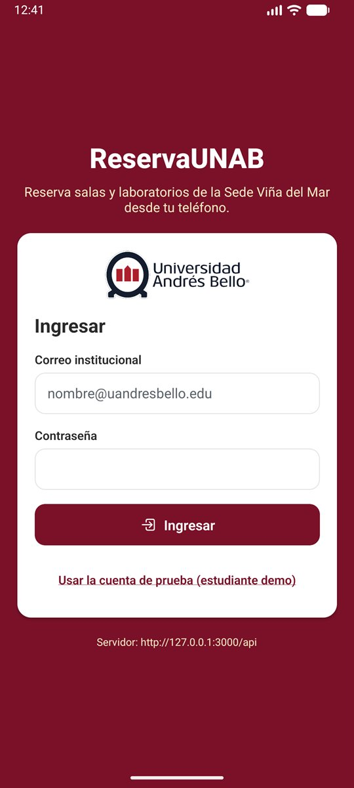 | 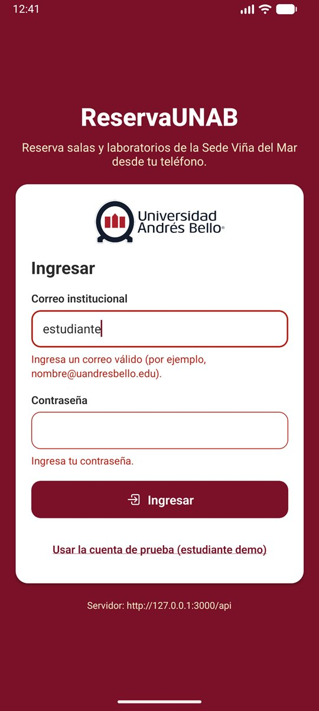 | 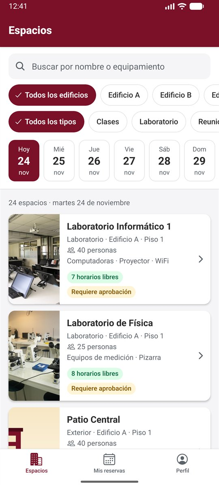 | 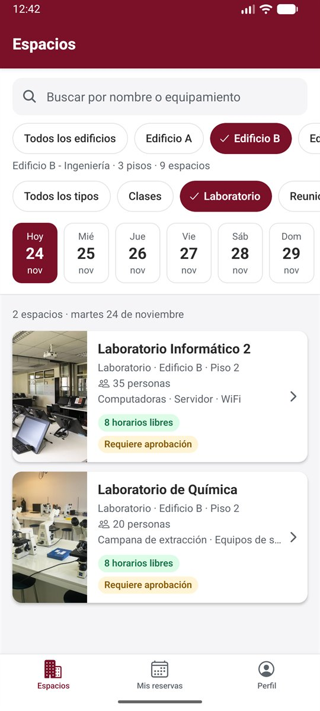 |

| Espacio | Disponibilidad | Nueva reserva (validación) | Reserva enviada |
|---|---|---|---|
| 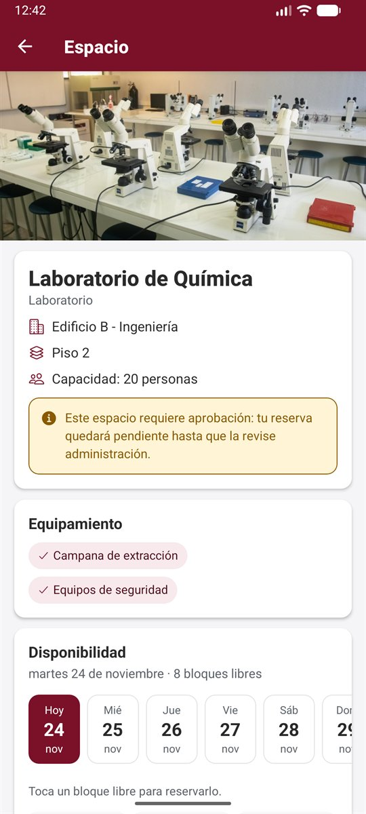 | 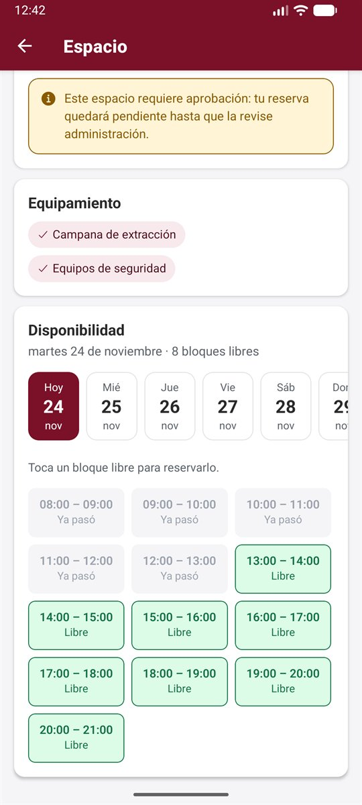 | 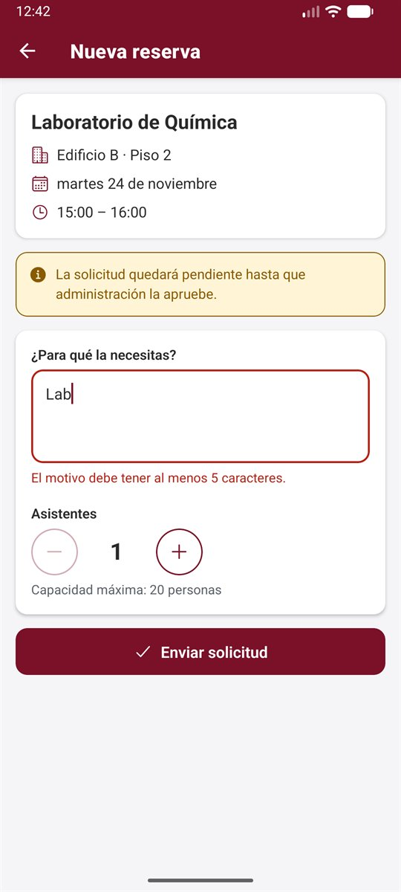 | 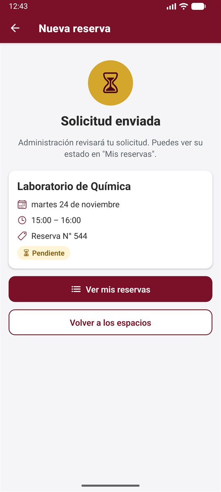 |

| Error de la API | Mis reservas | Mi reserva | Cancelada |
|---|---|---|---|
| 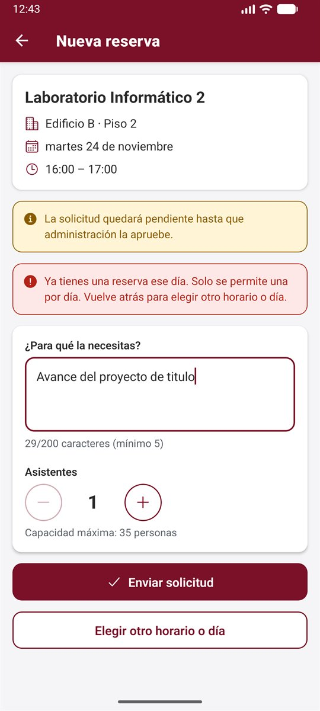 | 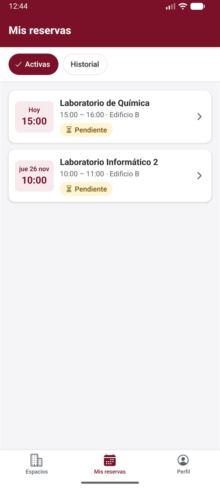 | 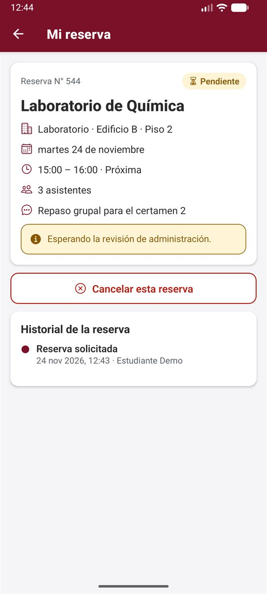 | 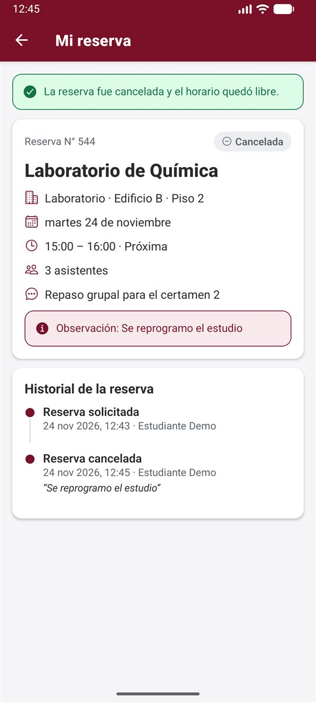 |

## Estructura

```
./
├── App.js                      proveedor de sesión + navegación
├── app.json                    nombre, ícono y plugins de Expo
├── .env.example                ejemplo de EXPO_PUBLIC_API_URL
├── assets/                     logo e imágenes de los espacios (las mismas de la web)
└── src/
    ├── config.js               dirección base de la API y constantes
    ├── theme.js                colores (burdeo y dorado de la web) y estados de reserva
    ├── services/
    │   ├── api.js              cliente HTTP reutilizable: token, tiempo de espera, errores
    │   ├── reservaunabApi.js   una función por endpoint
    │   └── almacenamiento.js   guarda la sesión (expo-secure-store)
    ├── context/SesionContext.js  inicio y cierre de sesión
    ├── hooks/
    │   ├── useConsulta.js      datos + estados de carga/error de una consulta
    │   └── useAlVolver.js      actualiza la pantalla al volver a ella
    ├── navigation/Navegacion.js  pestañas inferiores + pila de pantallas de detalle
    ├── screens/                Ingresar, Espacios, DetalleEspacio, Reservar, MisReservas, DetalleReserva, Perfil
    ├── components/             Boton, Campo, Chip, SelectorDia, EspacioItem, ReservaItem, EtiquetaEstado, Estados
    └── utils/                  fechas, textos, validaciones, imágenes, confirmar
```

## Decisiones de diseño móvil

- **Pestañas inferiores** para las tres tareas principales y una **pila** para los detalles: es el patrón que el
  usuario espera en Android e iOS, y el botón "atrás" de Android funciona solo.
- **Reservar desde la grilla de bloques**: en la web se elige el horario en un formulario; en el teléfono es más
  rápido tocar directamente un bloque libre.
- **Controles táctiles**: botones de al menos 48 px de alto, contador − / + para asistentes en vez de escribir un
  número, selector de días deslizable y "deslizar para actualizar" en las listas.
- **Teclado**: `KeyboardAvoidingView` para que no tape el formulario en iOS, teclado de correo en el ingreso y
  `SafeAreaView` para el notch.
- **Validar dos veces**: el formulario avisa al tiro (motivo de 5 a 200 caracteres, asistentes ≤ capacidad), pero
  la API vuelve a validar y sus mensajes se muestran tal cual.

## Limitaciones

- No hay registro de cuentas ni funciones de administración en el móvil (aprobar, rechazar, editar espacios):
  el enunciado no las pide y siguen en la web. Un administrador puede ingresar, pero solo ve sus propias reservas.
- Las fechas se calculan con la hora del teléfono; la API valida con la hora de Chile.
- Sin conexión no se puede reservar ni consultar: la app no guarda datos localmente (la fuente de verdad es la API).

## Uso de Inteligencia Artificial (Hito 4)

| | |
|---|---|
| **Herramientas** | Claude (Anthropic) y el skill de diseño Impeccable para Claude Code |
| **Propósito** | Claude: analizar el enunciado, revisar el código de la API del Hito 3 para identificar los endpoints que necesita el móvil, generar la app (navegación, cliente HTTP, pantallas, componentes y validaciones) y la documentación. Impeccable: revisar el diseño de la app según las pautas de Android (Material 3) y de accesibilidad, y aplicar las correcciones |
| **Prompt representativo** | "Debo continuar con el Hito 4", con el enunciado adjunto y acceso al repositorio del Hito 3. Para el diseño, se ejecutó Impeccable sobre la carpeta `mobile/` |
| **Resultado** | La carpeta `mobile/` y este README. Impeccable modificó solo estilos, sin cambiar la lógica ni las llamadas a la API |

**Elementos generados o asistidos por IA:**
- Toda la estructura de `mobile/`: `services/api.js` y `reservaunabApi.js` (cliente HTTP y una función por endpoint),
  el contexto de sesión con el token JWT, los hooks `useConsulta` y `useAlVolver`, las 7 pantallas y los componentes.
- La detección automática de la dirección de la API (`config.js`) y el README.
- Cambios de Impeccable:
  - **Contraste:** se oscurecieron los grises y los verdes y amarillos de los textos para cumplir la relación 4,5:1 (AA).
  - **Tipografía:** una escala de texto común (`tipografia` en `theme.js`) en vez de tamaños sueltos en cada pantalla.
  - **Controles táctiles:** áreas de toque de 48 dp en los chips, el botón para borrar la búsqueda y el enlace de la cuenta de prueba.
  - **Filtros:** los chips seleccionados muestran un check, como los filter chips de Material 3.
  - **Formularios y detalles:** borde burdeo en el campo que se está editando, números con ancho fijo en las horas,
    y el tipo de espacio movido bajo el nombre en vez de un rótulo dorado en mayúsculas (el dorado sobre blanco no se leía bien).

**Qué verificamos, corregimos o descartamos:**
- Antes de instalar la app, comprobamos que los endpoints que usa existen en el backend del Hito 3 y que no fue
  necesario modificar la API.
- Revisamos los cambios de Impeccable archivo por archivo antes de aceptarlos y confirmamos que solo tocaban estilos
  y textos, no la lógica.
- Probamos la app en el emulador de Android (Medium Phone, API 37) con el Hito 3 corriendo en Docker:
  - ingreso con validaciones y error de credenciales;
  - catálogo con filtros por edificio y tipo;
  - disponibilidad por día;
  - solicitud de una reserva en un espacio que requiere aprobación (quedó pendiente);
  - el error de la API "Ya tienes una reserva ese día";
  - Mis reservas y el historial de la reserva, que viene de MongoDB;
  - cancelación con motivo, que quedó registrada en el historial;
  - el perfil.
- Revisamos en la aplicación web, con la misma cuenta, que la
  reserva creada y cancelada desde el móvil aparecía con el mismo estado.
- Las capturas preliminares, tomadas en un navegador, se reemplazaron por capturas del emulador.
- Descartamos agregar registro de cuentas y funciones de administración en el móvil, porque el enunciado no las pide
  y ya existen en la web.

**Aprendizaje:**
- Un segundo cliente no necesita backend nuevo. Si las reglas de negocio están en la API, el móvil solo muestra lo
  que la API responde, y los dos clientes quedan siempre consistentes.
- En el emulador, `localhost` es el propio emulador y no el computador. Por eso la dirección de la API se configura
  aparte (`10.0.2.2`, la IP de la red o `EXPO_PUBLIC_API_URL`).
- CORS solo lo aplica el navegador. La app nativa no lo necesita, así que no hubo que cambiar la configuración de la API.
- En el teléfono, el token se guarda en el almacenamiento seguro del sistema (`expo-secure-store`) y no en
  `localStorage`, que no existe en React Native.
- Diseñar para móvil no es achicar la web. Importan el tamaño mínimo de los toques, el contraste para leer al aire
  libre, que el teclado no tape los campos y que el botón "atrás" de Android funcione.
